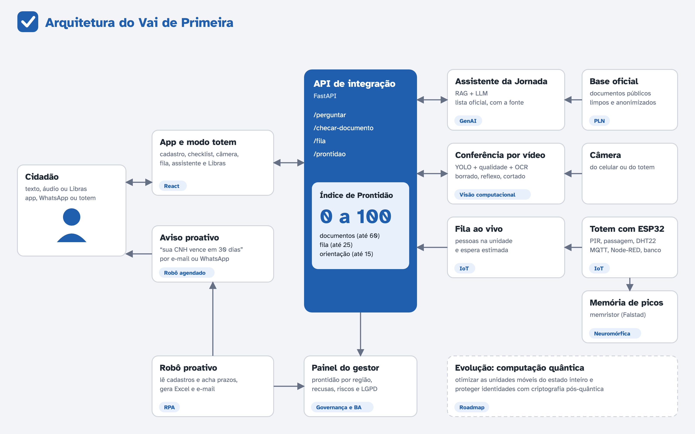

<p align="center">
  
</p>

<p align="center"><b>O serviço público que procura o cidadão e resolve tudo na primeira ida.</b></p>

---

## Sobre

Tirar a Carteira de Identidade Nacional, renovar a CNH ou se inscrever no Cadastro Único costuma exigir mais de uma ida à central de atendimento. Falta um documento, a foto da certidão fica ilegível, o comprovante está no nome de outra pessoa ou a fila é imprevisível. Para quem mora longe ou tem pouco acesso à internet, cada viagem perdida custa passagem e um dia de trabalho.

O **Vai de Primeira** inverte essa lógica. O sistema avisa a pessoa antes dos prazos, explica exatamente o que levar, confere os documentos pela câmera do celular e mostra a fila das unidades em tempo real. A pessoa só sai de casa quando está pronta.

## Como funciona

| Etapa | O que o cidadão vê |
|---|---|
| **Aviso proativo** | *"Sua CNH vence em 30 dias. Quer conferir o que precisa?"* |
| **Assistente da Jornada** | A lista oficial do que levar, se o serviço é gratuito e onde ir, com a fonte de cada informação. Por texto, áudio ou Libras. |
| **Conferência por vídeo** | Aponta a câmera para os documentos e recebe o retorno na hora: *"a certidão está com reflexo, incline o papel"*. |
| **Fila ao vivo** | A espera de cada unidade, medida por sensores no totem de atendimento. |
| **Índice de Prontidão** | Uma nota de 0 a 100 com a chance de resolver na primeira ida, e o que falta para chegar lá. |

Para o gestor público, um painel mostra a prontidão por região, os motivos de recusa de documentos e onde a unidade móvel é mais necessária.

Escopo atual: **Carteira de Identidade Nacional, renovação da CNH e Cadastro Único.**

## Arquitetura

<p align="center"></p>

| Módulo | Pasta | Descrição |
|---|---|---|
| API de integração | [`api/`](api/) | Ponto único de acesso do app e do totem. Calcula o Índice de Prontidão. |
| App e modo totem | [`frontend/`](frontend/) | Aplicação web do cidadão em React, com modo totem acessível. |
| Assistente da Jornada | [`genai/`](genai/) | Agente com recuperação de documentos oficiais (RAG) e LLM. |
| Base de conhecimento | [`pln/`](pln/) | Pipeline que transforma documentos públicos em corpus limpo e anonimizado. |
| Conferência por vídeo | [`visao/`](visao/) | Detecção e avaliação de qualidade de documentos em imagem e vídeo. |
| Totem e fila ao vivo | [`iot/`](iot/) | ESP32 com sensores, MQTT, Node-RED e banco de dados. |
| Aviso proativo | [`rpa/`](rpa/) | Robô agendado que identifica prazos e envia avisos e relatórios. |
| Memória de picos | [`memristor/`](memristor/) | Estudo de memória resistiva para registrar horários de sobrecarga. |
| Roadmap quântico | [`quantica/`](quantica/) | Estudo de otimização e criptografia pós-quântica para escala estadual. |
| Painel e governança | [`governanca/`](governanca/) | Painel do gestor, matriz de riscos de IA e LGPD. |

Os formatos de dados trocados entre os módulos estão em [docs/contratos.md](docs/contratos.md).

## Tecnologias

Python · FastAPI · LangChain · Groq · YOLO · OpenCV · React · Vite · ESP32 · MQTT · Node-RED · SQLite

## Executando localmente

### API
```bash
cd api
python3 -m venv .venv && source .venv/bin/activate
pip install -r requirements.txt
uvicorn main:app --reload
```
A documentação interativa fica em http://127.0.0.1:8000/docs.

Enquanto os módulos de visão, assistente e sensores são finalizados, os endpoints correspondentes respondem com **dados de demonstração** no formato definitivo, identificados pelo campo `"simulado": true`. Assim o app pode ser desenvolvido em paralelo. Cada endpoint passa a usar o módulo real assim que ele é integrado.

### Testes
```bash
cd api && python -m pytest -q
```

### Configuração
Copie `.env.example` para `.env` e preencha as chaves. O arquivo `.env` não é versionado.

## Privacidade

O sistema lida com dados de identificação, que são sensíveis pela LGPD. Neste repositório:
- todas as pessoas e documentos são **fictícios** (veja [docs/personas.md](docs/personas.md));
- nenhum dado pessoal real é enviado a serviços externos;
- chaves de acesso ficam fora do código.

## Equipe

| Nome | RM | Áreas |
|---|---|---|
| Pedro Iavarone Custódio | RM567638 | Assistente da Jornada (GenAI), Governança, Visão Computacional |
| João Pedro de Souza Nunes | RM567318 | Base de conhecimento (PLN), Computação Quântica, IoT |
| Guilherme Nakamura | RM567460 | Front-end, Memória de picos (Cluster), Aviso proativo (RPA) |

Projeto desenvolvido no desafio CitizenTech da FIAP (2026).
